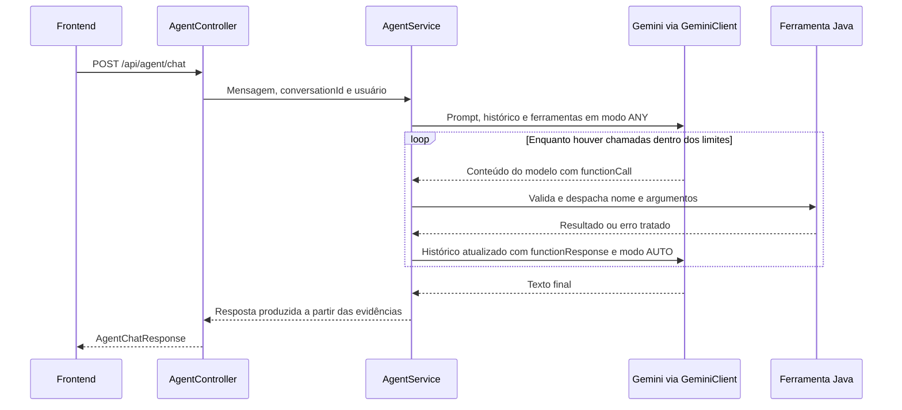

# Function calling no DataTerra

O function calling permite que o Gemini peça ao backend para executar uma operação durante uma conversa. O modelo escolhe uma ferramenta e propõe argumentos. O backend Java confere a chamada, executa a operação autorizada e devolve seu resultado ao modelo. O Gemini usa esse resultado para redigir a resposta ou pedir outra operação.

Por exemplo, para responder “Quantos data centers existem em São Paulo?”, o Gemini pode pedir `consultar_dataterra` com `operacao=CONTAR` e `estado=SP`. Quem consulta o PostgreSQL e determina a contagem é o backend.

## Fluxo de uma pergunta



1. O frontend envia `message` e, para continuar uma conversa, `conversationId`. O controller passa também a identidade do usuário, quando disponível. O serviço recupera o histórico e as evidências da conversa e acrescenta a pergunta atual.
2. Em cada rodada, `GeminiClient.generate` envia um POST a `/models/{model}:generateContent`. O corpo inclui `systemInstruction`, `contents`, `tools[].functionDeclarations`, `toolConfig.functionCallingConfig.mode` e `generationConfig`. O prompt orienta a escolha, os schemas descrevem as ferramentas e o código Java aplica as validações efetivas.
3. A primeira rodada de cada pergunta usa `ANY`, que exige uma chamada de ferramenta. A partir da segunda, `AUTO` permite que o modelo escolha entre chamar ferramentas e responder em texto.
4. `AgentService.run` acrescenta ao histórico todo o conteúdo retornado pelo modelo, incluindo eventuais `thoughtSignature`. Em seguida, percorre `parts` e executa cada `functionCall` sequencialmente. Se a rodada contém chamadas, ela é tratada como intermediária mesmo quando também contém texto.
5. Cada resultado vira uma parte `functionResponse`. O serviço monta uma mensagem com `role: "user"` e agrupa nela as respostas às chamadas da rodada. O conteúdo original do modelo e essa mensagem seguem juntos no histórico enviado na próxima rodada.
6. Quando a rodada contém apenas texto, o serviço aceita uma resposta não vazia se tiver evidência de dados ou se `resposta_conceitual` já tiver sido aceita. Partes marcadas como `thought` são ignoradas na montagem do texto. Para resultados de municípios e visualizações, o backend monta a apresentação final com os dados estruturados.
7. Ao concluir o turno, o serviço salva a pergunta, a resposta, a fonte e as evidências. O identificador da conversa permite recuperar esse contexto na próxima pergunta.

## Formato de uma chamada e de sua resposta

Exemplo ilustrativo de uma parte produzida pelo Gemini. O `id` aparece quando o modelo fornece um identificador.

```json
{
  "functionCall": {
    "id": "call-1",
    "name": "consultar_dataterra",
    "args": {
      "operacao": "CONTAR",
      "estado": "SP"
    }
  }
}
```

Parte devolvida pelo backend ao Gemini. O total abaixo é fictício e o resultado foi abreviado.

```json
{
  "functionResponse": {
    "id": "call-1",
    "name": "consultar_dataterra",
    "response": {
      "operacao": "CONTAR",
      "resultado": {
        "total": 42
      }
    }
  }
}
```

O backend repete o `name` e copia o mesmo `id` se ele estiver presente como texto na chamada. Uma chamada sem `args` é interpretada como um objeto vazio. Se `args` vier em outro formato, recebe um erro. As chaves internas de evidência são tratadas antes do envio ao Gemini. Em visualizações, o modelo recebe metadados apropriados para planejar a apresentação, enquanto o backend usa os registros efetivos para montá-la.

## Ferramentas disponíveis

| Ferramenta | Argumentos | Trabalho executado pelo backend |
| --- | --- | --- |
| `consultar_dataterra` | `operacao` obrigatória. Filtros e controles opcionais conforme a operação. | Valida filtros e consulta o PostgreSQL por meio de serviços e consultas predefinidas. Pode reunir páginas dentro dos limites configurados. |
| `resposta_conceitual` | Objeto vazio. | Registra a passagem pelo caminho conceitual e devolve uma orientação para o Gemini explicar o conceito ou pedir esclarecimento. |
| `comparar_contagens` | `estadoA` e `estadoB` obrigatórios. `percentualSobre` e `atualizar` opcionais. | Obtém contagens documentadas na conversa ou consulta o banco. Calcula a diferença absoluta, identifica o maior total ou empate e, com denominador informado, calcula o percentual. |
| `planejar_visualizacao` | `type` obrigatório no schema. Pode propor `datasetId`, `chartType`, `x`, `y`, `series`, `yFields` e opções de apresentação. | Valida um plano de tabela ou gráfico contra os dados autorizados, seus campos e tipos. A especificação final usa as linhas consultadas pelo backend. |

### Consultas ao DataTerra

| Operação | Resultado | Filtros e opções específicos |
| --- | --- | --- |
| `CONTAR` | Total de instalações | `estado`, `cidade`, `empresa`, `nome` |
| `LISTAR` | Instalações | `estado`, `cidade`, `empresa`, `nome`, `dataCenterId` |
| `ESTADOS` | Contagens por estado | Paginação |
| `MUNICIPIOS` | Município, UF e quantidade de instalações | `estado`, `cidade`, `empresa`, `nome`, `todos`, `ranking` |
| `OPERADORES` | Operadores e contagens | `estado`, `cidade`, `empresa`, `nome` |
| `INDICADORES`, `BENEFICIOS`, `PESQUISAS` | Registros do domínio escolhido | `dataCenterId`, `termo` |
| `NOTICIAS` | Notícias armazenadas | `termo` |
| `FONTES` | Fontes documentais | `dataCenterId`, `fonteId` |

A paginação começa em `pagina=0` e aceita `limite` de 1 a 50 por página. Para um ranking de dez municípios, a declaração orienta o uso de `MUNICIPIOS` com `ranking=true`, `limite=10` e `todos=false`. Solicitações de lista completa podem acionar a recuperação de várias páginas. O serviço de paginação geral tem limites padrão de 2.000 registros e 100 páginas. `MUNICIPIOS` tem tratamento próprio em `AgentDataBaseService`.

Chamadas idênticas a `consultar_dataterra` reutilizam o resultado durante a mesma pergunta. Uma nova pergunta inicia outro cache. Operações, argumentos, tipos, limites e combinações de filtros são controlados pelo Java. O backend executa consultas de leitura predefinidas e recebe filtros estruturados.

### Comparações e visualizações

- Em `comparar_contagens`, o histórico só pode fornecer uma contagem que corresponda a uma consulta filtrada exclusivamente pelo estado em questão. Com `atualizar=true`, ambas as contagens são refeitas. `percentualSobre` deve ser um dos dois estados. O cálculo divide a diferença absoluta pelo total desse estado e multiplica por 100. Um denominador zero gera uma indicação de percentual indefinido.
- Em `planejar_visualizacao`, os valores vêm de uma consulta autorizada. O modelo propõe campos e formato. O backend valida o plano e pode reutilizar um dataset da própria conversa em uma conversão de formato. Quando a evidência histórica está marcada para atualização, a reutilização dos dados depende de refazer a consulta com os filtros preservados.

## Limites, falhas e rastreabilidade

| Situação | Comportamento |
| --- | --- |
| Ferramenta desconhecida ou argumento inválido | Retorna `erro` em `functionResponse`. Erros de validação incluem uma orientação para o modelo corrigir a chamada. |
| Falha durante uma ferramenta | A resposta da ferramenta informa indisponibilidade sem expor a exceção. Uma consulta vazia concluída com sucesso continua sendo um resultado válido. |
| Limite do turno | Até seis rodadas do modelo e doze chamadas de ferramenta por pergunta. Chamadas inválidas também contam. |
| Falha transitória de comunicação com o Gemini | Até três tentativas por rodada em falhas de acesso ou HTTP 429, 500, 502, 503 e 504. As pausas entre tentativas são de 250 e 500 ms. |
| Gemini indisponível, resposta inválida ou rodadas esgotadas | Com evidência disponível para o turno, o backend pode gerar a resposta local com `AgentFallbackFormatter`. Sem evidência, o fluxo encerra com HTTP 503. |

`AgentToolTelemetry` registra ferramenta, operação, duração, cache e status. `AgentSqlCapture` observa o SQL JDBC executado durante os escopos de consulta e `AgentSqlEvidence` associa essas consultas às evidências do turno. A exposição do SQL na resposta HTTP depende da configuração de depuração.

## Onde encontrar cada etapa

| Arquivo | Responsabilidade |
| --- | --- |
| [AgentController.java](src/main/java/data_centers/brasil/agent/controller/AgentController.java) | Entrada HTTP em `POST /api/agent/chat`. |
| [AgentService.java](src/main/java/data_centers/brasil/agent/service/AgentService.java) | Modos `ANY` e `AUTO`, loop, chamadas autorizadas, montagem de `functionResponse`, evidências e fallback. |
| [GeminiClient.java](src/main/java/data_centers/brasil/agent/client/GeminiClient.java) | Corpo HTTP, chamada `generateContent`, validação do candidato retornado e novas tentativas. |
| [AgentToolDeclarations.java](src/main/java/data_centers/brasil/agent/tool/AgentToolDeclarations.java) | Nomes, descrições e schemas JSON apresentados ao modelo. O despacho de cada nome fica em `AgentService`. |
| [AgentContext.java](src/main/java/data_centers/brasil/agent/context/AgentContext.java) e [system-prompt.txt](src/main/resources/agent/system-prompt.txt) | Carregamento e instruções do sistema que orientam o uso das ferramentas. |
| [AgentDataBaseService.java](src/main/java/data_centers/brasil/agent/service/AgentDataBaseService.java) | Enum de operações, validação dos argumentos e execução de consultas de leitura. |
| [AgentQueryPaginationService.java](src/main/java/data_centers/brasil/agent/service/AgentQueryPaginationService.java) | Paginação e metadados do dataset criado pela consulta. |
| [AgentQueryRepository.java](src/main/java/data_centers/brasil/agent/repository/AgentQueryRepository.java) | Consultas predefinidas usadas pelo serviço do agente. |
| [AgentComparisonService.java](src/main/java/data_centers/brasil/agent/service/AgentComparisonService.java) | Reuso de contagens, novas consultas quando necessário e cálculo das comparações. |
| [AgentVisualizationService.java](src/main/java/data_centers/brasil/agent/visualization/AgentVisualizationService.java) e [AgentDatasetService.java](src/main/java/data_centers/brasil/agent/visualization/AgentDatasetService.java) | Validação do plano, seleção dos datasets autorizados e montagem da visualização. |
| [AgentConversationService.java](src/main/java/data_centers/brasil/agent/memory/AgentConversationService.java) | Carregamento de histórico e evidências e persistência do turno concluído. |
| [AgentFallbackFormatter.java](src/main/java/data_centers/brasil/agent/formatter/AgentFallbackFormatter.java) | Formatação local das evidências para a resposta. |
| [AgentToolTelemetry.java](src/main/java/data_centers/brasil/agent/service/AgentToolTelemetry.java), [AgentSqlCapture.java](src/main/java/data_centers/brasil/agent/sql/AgentSqlCapture.java) e [AgentSqlEvidence.java](src/main/java/data_centers/brasil/agent/sql/AgentSqlEvidence.java) | Registro da execução e associação do SQL observado às evidências. |
| [AgentChatResponse.java](src/main/java/data_centers/brasil/agent/dto/AgentChatResponse.java) | Estrutura devolvida ao frontend ao concluir o turno. |

## Testes que demonstram o fluxo

- [AgentServiceTests.java](src/test/java/data_centers/brasil/agent/service/AgentServiceTests.java) cobre o ciclo completo da chamada, o retorno de IDs e assinaturas, chamadas múltiplas, argumentos corrigidos em outra rodada, bloqueio de ferramentas desconhecidas, cache e fallback.
- [AgentDatabaseIntegrationTests.java](src/test/java/data_centers/brasil/agent/service/AgentDatabaseIntegrationTests.java) e [AgentMunicipiosIntegrationTests.java](src/test/java/data_centers/brasil/agent/service/AgentMunicipiosIntegrationTests.java) exercitam operações e filtros sobre a base de teste.
- [AgentConversationIntegrationTests.java](src/test/java/data_centers/brasil/agent/service/AgentConversationIntegrationTests.java) e [AgentVisualizationIntegrationTests.java](src/test/java/data_centers/brasil/agent/service/AgentVisualizationIntegrationTests.java) cobrem o contexto conversacional e a execução de visualizações a partir de evidências.

## Onde as queries são executadas e como são montadas

A entrada para as consultas é o método `executar` de [AgentDataBaseService.java](src/main/java/data_centers/brasil/agent/service/AgentDataBaseService.java). Quando recebe `consultar_dataterra`, o [AgentService.java](src/main/java/data_centers/brasil/agent/service/AgentService.java) passa os argumentos ao [AgentQueryPaginationService.java](src/main/java/data_centers/brasil/agent/service/AgentQueryPaginationService.java), que chama `executar` para a página solicitada e repete a operação quando precisa reunir páginas. `executar` valida os argumentos e escolhe o caminho pelo `switch` de `Operacao`. O Gemini envia o nome da operação e os valores dos filtros. O Java determina campos, condições e ordenação.

### Consultas geradas pelo Hibernate

| Operação | Onde a consulta é disparada |
| --- | --- |
| `CONTAR` | [DataCenterService.count](src/main/java/data_centers/brasil/service/DataCenterService.java) chama `DataCenterRepository.count(specification)`. |
| `LISTAR` | [DataCenterService.list](src/main/java/data_centers/brasil/service/DataCenterService.java) chama `DataCenterRepository.findAll(specification, pageable)`. |
| `INDICADORES`, `BENEFICIOS`, `PESQUISAS` | Os métodos `list` de [IndicadorAmbientalService](src/main/java/data_centers/brasil/service/IndicadorAmbientalService.java), [BeneficioService](src/main/java/data_centers/brasil/service/BeneficioService.java) e [ConteudoPesquisaService](src/main/java/data_centers/brasil/service/ConteudoPesquisaService.java) consultam os respectivos repositórios. O argumento `termo` vira filtro de `tipo` para indicadores e benefícios e de `conteudo` para pesquisas. |
| `FONTES` | [FonteService.list](src/main/java/data_centers/brasil/service/FonteService.java) consulta as fontes. Com `dataCenterId`, [DataCenterFonteService.list](src/main/java/data_centers/brasil/service/DataCenterFonteService.java) consulta os vínculos, acrescenta a condição pelo ID da instalação e aplica os filtros aos campos da fonte. |

Por exemplo, uma chamada `CONTAR` com `estado=São Paulo` e `cidade=Campinas` vira `estadoEq=SP` e `cidadeEq=Campinas` em `AgentDataBaseService`. O [QueryFilterParser.java](src/main/java/data_centers/brasil/filter/QueryFilterParser.java) interpreta o sufixo `Eq` como igualdade e usa [FilterResource.java](src/main/java/data_centers/brasil/filter/FilterResource.java) para resolver cada campo permitido. O [JpaFilters.java](src/main/java/data_centers/brasil/filter/JpaFilters.java) converte as condições em predicados da Criteria API, aplica a normalização pertinente e os combina com `AND`. O Hibernate gera e executa a consulta de contagem com essas condições.

No caso de `LISTAR`, o mesmo processo gera uma consulta para recuperar registros. `AgentDataBaseService` passa um `PageRequest` com página, tamanho e ordenação por `id`. O Spring Data pode executar uma consulta adicional de contagem para preencher o total da página.

### Consultas SQL escritas em Java e executadas pelo JdbcTemplate

O SQL das operações abaixo está em [AgentQueryRepository.java](src/main/java/data_centers/brasil/agent/repository/AgentQueryRepository.java).

| Operação | Como a query é montada |
| --- | --- |
| `ESTADOS` | `estados` agrupa `data_center` por `UPPER(TRIM(estado))`, conta as instalações e ordena por quantidade decrescente e estado. |
| `MUNICIPIOS` | `municipios` agrupa pela UF e pelo nome normalizado da cidade. A primeira consulta conta os grupos para calcular o total de municípios. A segunda retorna uma página de municípios e suas contagens. Com `ranking=true`, a ordenação começa pela quantidade decrescente. |
| `OPERADORES` | `operadores` exclui empresas sem nome, aplica os filtros fornecidos, agrupa por `empresa` e ordena pela quantidade decrescente. |
| `NOTICIAS` | `noticias` aplica `POSITION` para buscar o termo em título, descrição e categoria convertidos para minúsculas, e ordena pela data de publicação mais recente e pelo ID. |

Para municípios e operadores, o repositório usa o mesmo `QueryFilterParser` e passa as condições para [SqlFilters.java](src/main/java/data_centers/brasil/filter/SqlFilters.java). Ele devolve o fragmento SQL e os valores em estruturas separadas. Por exemplo, `estadoEq=SP` produz uma comparação entre a expressão normalizada da coluna `estado` e um marcador `?`. O repositório acrescenta o fragmento à consulta, depois passa o valor normalizado, o `LIMIT` e o `OFFSET` como parâmetros ao `JdbcTemplate`. Em uma página comum, o deslocamento é `pagina × limite`. As expressões de coluna vêm de `FilterResource` e os trechos de agrupamento e ordenação ficam no código Java.

`comparar_contagens` segue o caminho JPA de `CONTAR` quando precisa buscar totais atualizados ou preencher uma contagem ausente. A visualização usa as linhas obtidas por esses caminhos. Em uma conversão com dados já disponíveis, o backend pode reutilizar a consulta anterior a partir das evidências da conversa.
