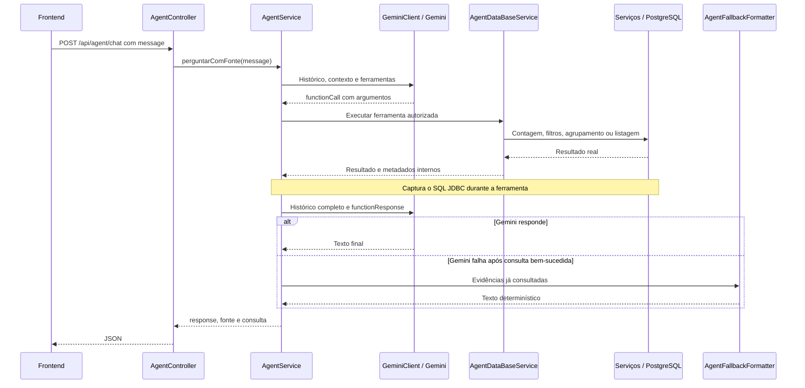

# Agente de IA do DataTerra

> Atualização de busca e memória: consulte também [AGENT-CONVERSAS.md](AGENT-CONVERSAS.md), com a migração aditiva, explicação dos novos arquivos, conversationId, cálculos, logs, configuração e exemplos HTTP.

Documentação da implementação do agente de IA do backend DataTerra: organização dos arquivos, fluxo de execução, integração com o Gemini, ferramentas autorizadas, consultas ao banco, fallback e contrato HTTP.

Este documento descreve o código existente. Exemplos com quantidades são ilustrativos e não representam consultas à base de produção.

## Índice

1. [Objetivo](#1-objetivo)
2. [Estrutura](#2-estrutura)
3. [Fluxo de execução](#3-fluxo-de-execução)
4. [Cada arquivo explicado](#4-cada-arquivo-explicado)
5. [Ferramentas e operações](#5-ferramentas-e-operações)
6. [Filtros e paginação](#6-filtros-e-paginação)
7. [Contrato da API](#7-contrato-da-api)
8. [SQL exato](#8-sql-exato)
9. [Fallback](#9-fallback)
10. [Erros e limites](#10-erros-e-limites)
11. [Configuração](#11-configuração)
12. [Segurança e confiabilidade](#12-segurança-e-confiabilidade)
13. [Testes](#13-testes)
14. [Manutenção](#14-manutenção)
15. [Diagnóstico](#15-diagnóstico)
16. [Limitações](#16-limitações)

## 1. Objetivo

O agente responde perguntas em linguagem natural sobre os registros do DataTerra: instalações, operadores, distribuição geográfica, indicadores ambientais, notícias e fontes documentais.

| Componente | Responsabilidade |
| --- | --- |
| Gemini | Interpretar a intenção, selecionar ferramentas e redigir a resposta final quando disponível. |
| Spring Boot | Validar argumentos, executar ferramentas autorizadas, controlar a conversa e construir a resposta HTTP. |
| PostgreSQL | Fornecer os registros e agregações reais utilizados na resposta. |

O Gemini não recebe acesso direto ao PostgreSQL. Ele solicita operações estruturadas; o Java decide como executá-las usando serviços existentes e consultas fixas.

Uma pergunta sobre quantidade deve utilizar uma contagem real. Um ranking por estado utiliza agregação real. Um conceito geral, como o significado de PUE, pode ser respondido sem consultar instalações.

A quantidade cadastrada não equivale automaticamente ao total de data centers existentes ou em operação no Brasil.

## 2. Estrutura

```text
src/main/java/data_centers/brasil/agent/
├── client/
│   └── GeminiClient.java
├── context/
│   └── AgentContext.java
├── controller/
│   └── AgentController.java
├── dto/
│   └── AgentChatResponse.java
├── formatter/
│   └── AgentFallbackFormatter.java
├── repository/
│   └── AgentQueryRepository.java
├── service/
│   ├── AgentDataBaseService.java
│   └── AgentService.java
├── sql/
│   ├── AgentSqlCapture.java
│   └── AgentSqlCaptureConfiguration.java
└── tool/
    └── AgentToolDeclarations.java

src/main/resources/agent/
└── system-prompt.txt

src/test/java/data_centers/brasil/agent/
├── controller/
│   └── AgentControllerTests.java
├── formatter/
│   └── AgentFallbackFormatterTests.java
└── service/
    ├── AgentDatabaseIntegrationTests.java
    ├── AgentRawSqlIntegrationTests.java
    └── AgentServiceTests.java
```

Os arquivos específicos ficam no pacote `agent`. Os serviços gerais da plataforma continuam em seus pacotes originais e são reutilizados.

## 3. Fluxo de execução



1. O Spring Security verifica a autenticação.
2. O controller lê `message` e encaminha ao serviço.
3. O serviço rejeita mensagem nula, vazia ou maior que 4000 caracteres.
4. Sem conversationId cria uma conversa; com ID recupera o histórico persistido pertencente ao usuário autenticado.
5. O cliente envia contexto e declarações das ferramentas ao Gemini.
6. A primeira rodada usa `ANY`, exigindo a seleção de uma ferramenta: banco ou conceito.
7. O backend valida e executa a chamada.
8. O resultado é guardado como evidência; os SQLs são guardados separadamente.
9. O serviço envia o resultado ao Gemini em `functionResponse`.
10. Nas rodadas seguintes, `AUTO` permite novas ferramentas ou resposta textual.
11. Uma resposta válida resulta no JSON final.
12. Se a conversa falhar após obter evidências, o formatador produz o texto localmente.

O histórico preserva o conteúdo completo retornado pelo modelo, incluindo `thoughtSignature`. Quando a chamada possui `id`, a resposta da ferramenta devolve esse mesmo identificador.

Chamadas múltiplas em uma rodada são aceitas, mas executadas sequencialmente pelo backend. Não há paralelismo de ferramentas nessa implementação.

## 4. Cada arquivo explicado

### 4.1. `controller/AgentController.java`

Arquivo: [AgentController.java](src/main/java/data_centers/brasil/agent/controller/AgentController.java).

É a entrada HTTP. Usa `@RestController` e o caminho base `/api/agent`.

O método `chat(ChatRequest request, Principal principal)` atende `POST /api/agent/chat`, recebe message e conversationId opcional, repassa a identidade autenticada ao serviço e devolve o DTO resultante.

A validação da mensagem fica no serviço. O controller não conhece o protocolo do Gemini nem executa SQL.

### 4.2. `dto/AgentChatResponse.java`

Arquivo: [AgentChatResponse.java](src/main/java/data_centers/brasil/agent/dto/AgentChatResponse.java).

É o `record` da resposta HTTP:

```java
public record AgentChatResponse(
    String response,
    String fonte,
    List<String> consulta,
    UUID conversationId,
    String consultaOrigem
) {}
```

| Campo | Conteúdo |
| --- | --- |
| `response` | Texto para o usuário, produzido pelo Gemini ou formatador local. |
| `fonte` | Origem do contexto utilizado, determinada pelo backend. |
| `consulta` | SQL bruto capturado, liberado somente em desenvolvimento autorizado; lista vazia nos demais ambientes. |
| `conversationId` | UUID da conversa criada ou retomada, para reutilização pelo frontend. |
| `consultaOrigem` | atual, historico ou mista para o SQL retornado; nenhuma quando não houver SQL disponível e oculta quando a política do ambiente o bloquear. |

O construtor faz uma cópia imutável da lista de consultas. Essa lista não é preenchida pelo Gemini.

### 4.3. `service/AgentService.java`

Arquivo: [AgentService.java](src/main/java/data_centers/brasil/agent/service/AgentService.java).

Coordena a conversa. Recebe cliente Gemini, serviço de banco, formatador, memória persistente, configuração de debug, telemetria e serviço de comparação.

| Método | Responsabilidade |
| --- | --- |
| `perguntar(String question)` | Retorna somente o texto, delegando ao método completo; não é o método usado pelo controller. |
| `perguntarComFonte(String question)` | Entrada interna sem continuidade, preservada para chamadas diretas/testes; não é usada pelo controller HTTP. |
| `perguntarComFonte(String question, UUID conversationId, String owner)` | Entrada do endpoint: recupera/cria conversa, executa o turno, persiste o resumo e devolve o ID. |
| `fallback(...)` | Encaminha evidências ao formatador determinístico. |

Para cada pergunta, mantém variáveis locais com histórico, evidências, SQLs, quantidade de chamadas e indicação de uso da ferramenta conceitual.

Identifica `functionCall`, executa ferramentas permitidas, monta `functionResponse`, preserva IDs/assinaturas e escolhe o fallback.

Texto sem consulta bem-sucedida ou passagem pela ferramenta conceitual não é aceito como resposta verificada pelo fluxo.

O serviço não contém mais o prompt inicial, os schemas das ferramentas ou a implementação HTTP do Gemini.

### 4.4. `client/GeminiClient.java`

Arquivo: [GeminiClient.java](src/main/java/data_centers/brasil/agent/client/GeminiClient.java).

Comunica-se com o Gemini usando Spring `RestClient`. O construtor Spring recebe chave, URL, modelo, contexto e ferramentas. O segundo construtor aceita um cliente pronto para os testes.

O método `generate(history, mode)` monta:

| Propriedade | Conteúdo |
| --- | --- |
| `systemInstruction` | Instruções carregadas por `AgentContext`. |
| `contents` | Histórico da requisição atual. |
| `tools.functionDeclarations` | Declarações de `AgentToolDeclarations`. |
| `toolConfig.functionCallingConfig.mode` | `ANY` ou `AUTO`. |
| `generationConfig.temperature` | `0.1`. |
| `generationConfig.maxOutputTokens` | `2048`. |

A chamada é `POST /models/{model}:generateContent`, com a chave no header `x-goog-api-key`.

O cliente verifica candidatos e conteúdo. Se `finishReason` estiver informado, aceita apenas `STOP`. As validações das partes, ferramentas e texto continuam no serviço.

Também implementa timeouts, retries transitórios e backoff. Não decide qual consulta SQL executar.

### 4.5. `context/AgentContext.java`

Arquivo: [AgentContext.java](src/main/java/data_centers/brasil/agent/context/AgentContext.java).

Carrega `agent/system-prompt.txt` do classpath em UTF-8 uma vez durante a criação do componente Spring. O método `instrucoes()` fornece esse texto ao cliente.

Arquivo ausente, ilegível ou vazio impede a criação do componente. A aplicação não continua com um contexto silenciosamente ausente.

Alterações no arquivo-fonte exigem reiniciar/reimplantar para carregar o novo conteúdo. Não há recarga automática em execução.

### 4.6. `resources/agent/system-prompt.txt`

Arquivo: [system-prompt.txt](src/main/resources/agent/system-prompt.txt).

Contém as instruções iniciais separadas do Java. A extensão `.txt` não impede usar títulos e listas para organizar as regras.

O contexto atual aborda identidade, plataforma, prioridade aos dados reais, interpretação de perguntas, ferramentas, geografia, estatísticas, indicadores ambientais, impactos, operadores, notícias, fontes, ausência de dados, segurança, comunicação e falhas.

É o local adequado para mudar tom, orientações de confiabilidade e estilo de redação.

Instruções não criam funcionalidades: não adicionam ferramentas, colunas, memória de conversa ou busca na internet. Essas capacidades dependem do código.

### 4.7. `tool/AgentToolDeclarations.java`

Arquivo: [AgentToolDeclarations.java](src/main/java/data_centers/brasil/agent/tool/AgentToolDeclarations.java).

O método `declarations()` constrói os schemas JSON das funções disponíveis:

- `consultar_dataterra`: consulta estruturada, com `operacao` obrigatória.
- `resposta_conceitual`: pergunta geral, sem argumentos e sem banco.
- `comparar_contagens`: compara contagens documentadas de dois estados, com denominador e atualização explícitos.

O schema informa nomes, descrições, tipos e operações obtidas de `AgentDataBaseService.Operacao`.

A declaração ajuda o modelo a produzir argumentos. A validação definitiva continua no backend; o schema não autoriza SQL livre.

### 4.8. `service/AgentDataBaseService.java`

Arquivo: [AgentDataBaseService.java](src/main/java/data_centers/brasil/agent/service/AgentDataBaseService.java).

Executa operações autorizadas com `@Transactional(readOnly = true)`.

O método `executar(Map<?, ?> args)` rejeita chaves desconhecidas, valida operação, textos, números, IDs, UF e paginação, verifica compatibilidade dos filtros, monta os filtros existentes e executa a consulta.

Retorna o resultado com metadados internos: origem, operação, identidade da consulta, página, limite e limitações.

| Método auxiliar | Função |
| --- | --- |
| `contarDataCenters()` | Contagem global via `DataCenterService.count(...)`. |
| `consultarResumo()` | Delega a `CONTAR`; não carrega os primeiros 20 registros como resumo. |
| `paged(...)` | Converte `Page<?>` em registros, total e próxima página. |
| `text(...)` | Valida strings e remove espaços nas extremidades. |
| `integer(...)` | Valida tipo numérico, integralidade, valor finito e limites. |

O metadado interno `consulta` é um mapa dos filtros usado pelo fallback. Não deve ser confundido com o campo público `consulta`, que é uma lista de SQLs.

### 4.9. `repository/AgentQueryRepository.java`

Arquivo: [AgentQueryRepository.java](src/main/java/data_centers/brasil/agent/repository/AgentQueryRepository.java).

Concentra SQL fixo via `JdbcTemplate` para consultas não atendidas diretamente pelos serviços reutilizados.

| Método | Comportamento |
| --- | --- |
| `estados(size, offset)` | Agrupa `UPPER(TRIM(estado))`, conta e ordena por quantidade decrescente, com desempate por UF. |
| `municipios()` | Conta combinações distintas de cidade e UF normalizadas. Municípios homônimos em estados diferentes são distintos. |
| `operadores(size, offset)` | Agrupa por `empresa`, exclui nulos/vazios e ordena por quantidade e nome. |
| `noticias(term, size, offset)` | Pesquisa título, descrição e categoria; ordena por publicação recente. |

Operadores não são unificados por grafia/capitalização: o agrupamento usa o texto cadastrado em `empresa`.

Notícias usam `POSITION` com parâmetro vinculado. `%` e `_` não são curingas nessa busca. As descrições retornadas são limitadas a 2000 caracteres; datas nulas ficam por último e o ID desempata.

### 4.10. `formatter/AgentFallbackFormatter.java`

Arquivo: [AgentFallbackFormatter.java](src/main/java/data_centers/brasil/agent/formatter/AgentFallbackFormatter.java).

Gera texto legível com dados já obtidos quando a conversa não consegue terminar normalmente.

| Parte | Responsabilidade |
| --- | --- |
| `formatar(evidence)` | Entrada pública do formatador. |
| `Query` | Identifica operação e filtros para reunir somente resultados compatíveis. |
| `formatGroup(...)` | Consolida e apresenta cada grupo. |
| `line(...)` | Define a apresentação específica por operação. |
| `complete(...)` | Avalia cobertura dos intervalos, totais e término. |
| `rows(...)` e `row(...)` | Extraem campos conhecidos de mapas JDBC e DTOs existentes. |
| `context(...)` | Traduz filtros para descrições legíveis. |
| `title(...)` | Define títulos para os resultados. |
| Funções de números/estados | Aplicam formato `pt-BR` e convertem UF em nome. |

Não chama banco nem IA. Não concatena mapas ou DTOs inteiros na resposta. A tabela de nomes dos estados serve apenas à exibição; não acrescenta estados ou quantidades inexistentes.

### 4.11. `sql/AgentSqlCapture.java`

Arquivo: [AgentSqlCapture.java](src/main/java/data_centers/brasil/agent/sql/AgentSqlCapture.java).

É um escopo temporário de captura de SQL na thread atual, baseado em `ThreadLocal` e `AutoCloseable`.

| Método | Função |
| --- | --- |
| `iniciar()` | Abre um escopo e preserva eventual escopo anterior. |
| `executada(sql)` | Registra SQL somente com escopo ativo; chamado pela configuração JDBC. |
| `consultas()` | Retorna cópia imutável das strings capturadas. |
| `close()` | Restaura o escopo anterior ou remove o `ThreadLocal`. |

O serviço usa `try-with-resources`, limpando o escopo mesmo diante de exceções. Não há propagação automática da captura para tarefas assíncronas.

### 4.12. `sql/AgentSqlCaptureConfiguration.java`

Arquivo: [AgentSqlCaptureConfiguration.java](src/main/java/data_centers/brasil/agent/sql/AgentSqlCaptureConfiguration.java).

Configura a observação do SQL no nível JDBC.

`agentSqlDataSourcePostProcessor()` registra um `BeanPostProcessor` que envolve o `DataSource` em `CapturingDataSource`, sem alterar credenciais ou consultas.

A classe interna delega conexões ao `DataSource` real. Proxies de `Connection` observam a criação de `Statement`, `PreparedStatement` e `CallableStatement`; proxies dos statements observam a execução.

Após a execução retornar com sucesso, o SQL pode ser registrado no escopo ativo. Exceções reais são propagadas preservando a causa.

O wrapper envolve o acesso JDBC da aplicação, mas só acumula consultas quando há escopo ativo na thread. Não é um log global de consultas nem copia tráfego de outras threads para a resposta do agente.

## 5. Ferramentas e operações

### `consultar_dataterra`

O modelo envia argumentos estruturados, por exemplo:

```json
{
  "operacao": "CONTAR",
  "estado": "SP"
}
```

São argumentos internos do Function Calling. O frontend continua enviando somente `message`.

| Operação | Uso | Filtros específicos aceitos |
| --- | --- | --- |
| `CONTAR` | Quantidade real de instalações. | `estado`, `cidade`, `empresa`, `nome`. |
| `LISTAR` | Instalações e detalhes. | `estado`, `cidade`, `empresa`, `nome`, `dataCenterId`. |
| `ESTADOS` | Ranking/distribuição por UF. | Nenhum filtro específico; usa paginação. |
| `MUNICIPIOS` | Quantidade de municípios distintos com instalações. | Nenhum filtro específico. |
| `OPERADORES` | Empresas e quantidades de instalações. | estado, cidade, empresa e nome; usa paginação. |
| `INDICADORES` | Indicadores ambientais. | `dataCenterId`, `termo` no tipo. |
| `BENEFICIOS` | Benefícios documentados. | `dataCenterId`, `termo` no tipo. |
| `PESQUISAS` | Pesquisas e impactos documentados. | `dataCenterId`, `termo` no conteúdo. |
| `NOTICIAS` | Notícias cadastradas. | `termo` em título, descrição e categoria. |
| `FONTES` | Referências documentais. | `fonteId`, `dataCenterId`, inclusive combinados. |

`pagina` e `limite` são argumentos comuns. Em operações escalares como `CONTAR` e `MUNICIPIOS`, não reduzem o universo da contagem.

A ferramenta comparar_contagens compara dois estados, calcula diferença e percentual a partir de contagens documentadas ou atualizadas. CONTAR continua disponível para contagens individuais; veja AGENT-CONVERSAS.md.

Para indicadores de uma instalação, o modelo pode primeiro usar `LISTAR` para obter seu ID e depois `INDICADORES` e `FONTES`.

`MUNICIPIOS` é uma contagem distinta, não um ranking de municípios. `ESTADOS` não aceita filtro de cidade. O prompt não autoriza operações inexistentes.

### `resposta_conceitual`

Não aceita argumentos e não consulta o banco. Exemplo: “O que significa PUE?”

O backend orienta o Gemini a responder conceitos gerais sem atribuir conhecimento externo ao PostgreSQL DataTerra.

### Serviços existentes reutilizados

| Serviço | Reutilização |
| --- | --- |
| [DataCenterService](src/main/java/data_centers/brasil/service/DataCenterService.java) | `count(...)` e `list(...)` para contagens e filtros de instalações. |
| [IndicadorAmbientalService](src/main/java/data_centers/brasil/service/IndicadorAmbientalService.java) | Indicadores com filtros e paginação. |
| [BeneficioService](src/main/java/data_centers/brasil/service/BeneficioService.java) | Benefícios de instalações. |
| [ConteudoPesquisaService](src/main/java/data_centers/brasil/service/ConteudoPesquisaService.java) | Pesquisas e impactos documentados. |
| [FonteService](src/main/java/data_centers/brasil/service/FonteService.java) | Consulta de fontes. |
| [DataCenterFonteService](src/main/java/data_centers/brasil/service/DataCenterFonteService.java) | Fontes vinculadas a uma instalação. |

`ConsultaService` e `RadarService` continuam existindo no backend, mas não são chamados diretamente pelo `AgentDataBaseService` atual. A memória introduz somente a tabela agent_conversation, sem alterar instalações ou relacionamentos existentes.

## 6. Filtros e paginação

| Argumento/regra | Comportamento |
| --- | --- |
| `operacao` | Obrigatória e restrita ao enum autorizado. |
| Textos | Strings não vazias, até 200 caracteres; espaços nas extremidades são removidos. |
| `estado` | Convertido para maiúsculas e validado entre as 27 UFs, incluindo DF. |
| `pagina` | Inteiro de 0 a 1000; padrão 0. |
| `limite` | Inteiro de 1 a 50; padrão 20. |
| IDs | Inteiros positivos até `Integer.MAX_VALUE`. |
| Inteiros inválidos | Valores fracionários, não finitos ou fora do intervalo são rejeitados. |
| Chaves desconhecidas | Rejeitadas. |
| Filtros incompatíveis | Rejeitados, em vez de ignorados silenciosamente. |

Os filtros exatos de instalações por nome, empresa, cidade e estado normalizam acentos, caixa e espaços nos dois lados. Estados aceitam UF ou nome completo. A comparação continua por igualdade, sem transformar um nome em correspondência parcial.

As listagens via serviços retornam internamente:

```json
{
  "registros": [],
  "total": 0,
  "temProximaPagina": false
}
```

As listagens de serviços são ordenadas por ID. Rankings têm sua própria ordenação. Notícias usam data de publicação decrescente, datas nulas por último e desempate por ID.

`ESTADOS`, `OPERADORES` e `NOTICIAS` retornam somente a página solicitada, sem contar separadamente o total de grupos/notícias. Uma página cheia, isoladamente, não comprova que o conjunto terminou.

Contagens consideram toda a base compatível com os filtros, sem carregar todas as instalações para o modelo.

## 7. Contrato da API

### Endpoint

```http
POST /api/agent/chat
Content-Type: application/json
Authorization: Basic <credenciais válidas>
```

A autenticação HTTP Basic segue a configuração do backend em [SecurityConfig.java](src/main/java/data_centers/brasil/config/SecurityConfig.java).

### Request

```json
{
  "message": "Qual é a distribuição dos data centers por estado?"
}
```

### Response com dados do banco

Exemplo de formato, com quantidade ilustrativa:

```json
{
  "response": "São Paulo possui 112 data centers cadastrados no DataTerra.",
  "fonte": "banco_de_dados",
  "consulta": [
    "SELECT UPPER(TRIM(estado)) AS estado, COUNT(*) AS quantidade FROM data_center GROUP BY UPPER(TRIM(estado)) ORDER BY quantidade DESC, estado LIMIT ? OFFSET ?"
  ]
}
```

O texto do modelo pode variar. O SQL é capturado da execução, não criado para acompanhar a narrativa.

### Response conceitual

```json
{
  "response": "PUE relaciona a energia total utilizada por uma instalação à energia consumida pelos equipamentos de TI.",
  "fonte": "conhecimento_geral_gemini",
  "consulta": []
}
```

### Valores de `fonte`

| Valor | Significado |
| --- | --- |
| `banco_de_dados` | Consulta bem-sucedida sem ferramenta conceitual na resposta normal; também é o valor do fallback baseado nas evidências. |
| `conhecimento_geral_gemini` | Ferramenta conceitual sem consulta bem-sucedida ao banco. |
| `banco_de_dados_e_conhecimento_geral_gemini` | Ambas as ferramentas na conversa concluída normalmente. |

A origem é definida pelo backend, a partir dos caminhos executados; não classifica individualmente cada frase do texto. Uma consulta bem-sucedida sem registros também é consulta ao banco.

Não há valor `internet` no fluxo atual: o agente não pesquisa na web. Uma URL recuperada de notícias ou fontes é um dado do PostgreSQL e não comprova acesso ao site durante a pergunta.

`fonte` não substitui referências documentais: os IDs, títulos e URLs das fontes cadastradas são outra camada de rastreabilidade.

### Chamada local com PowerShell 7

Com o backend em execução e a URL local ajustada, quando necessário:

```powershell
$credencialDataTerra = Get-Credential
$corpoAgente = @{
    message = 'Quais são os cinco estados com mais data centers cadastrados?'
} | ConvertTo-Json

Invoke-RestMethod `
    -Uri 'http://localhost:8080/api/agent/chat' `
    -Method Post `
    -Authentication Basic `
    -AllowUnencryptedAuthentication `
    -Credential $credencialDataTerra `
    -ContentType 'application/json; charset=utf-8' `
    -Body $corpoAgente
```

HTTP e `AllowUnencryptedAuthentication` são utilizados aqui apenas para desenvolvimento local. Em implantação, utilize a URL HTTPS da aplicação. Esses parâmetros pertencem ao cliente PowerShell, não são novas configurações do agente.

## 8. SQL exato

O campo público consulta é uma lista de strings SQL, liberada somente com flag explícita em perfil de desenvolvimento autorizado. Fora disso retorna uma lista vazia. Os exemplos de SQL preenchido deste documento pressupõem essa autorização.

A captura acontece na fronteira JDBC e preserva caixa, espaços, aliases e placeholders do SQL enviado ao statement. O SQL é salvo junto à evidência para poder ser retornado quando essa evidência for reutilizada. consultaOrigem distingue consultas atuais, históricas e mistas.

Exemplo do texto definido no repositório para `ESTADOS`:

```sql
SELECT UPPER(TRIM(estado)) AS estado, COUNT(*) AS quantidade FROM data_center GROUP BY UPPER(TRIM(estado)) ORDER BY quantidade DESC, estado LIMIT ? OFFSET ?
```

Para JPA, o SQL é gerado pelo Hibernate. Aliases e sintaxe podem mudar conforme versão e dialect; a API devolve o texto observado, sem reconstruí-lo.

Regras:

- Inclui ferramentas concluídas com sucesso, mesmo com resultado vazio.
- Uma ferramenta pode gerar vários statements, como SELECT e COUNT da paginação, quando ambos forem realmente executados.
- Preserva os textos capturados e não elimina SQLs repetidos. Quando há reutilização, a lista também inclui as consultas originais das evidências históricas selecionadas; não é uma auditoria exclusiva das execuções do turno atual.
- Mantém consultas capturadas no fallback.
- Respostas conceituais retornam `[]`.
- Reutilizar histórico pode retornar o SQL original sem executá-lo novamente. Históricos antigos sem SQL salvo não têm suas consultas reconstruídas; uma atualização dos dados permite registrar novas execuções.
- Consultas de autenticação e outras threads fora do escopo não são acumuladas.
- Statements que lançam exceção na execução não são registrados como sucesso.
- Se a ferramenta inteira falhar após executar parte das consultas, o serviço atual não adiciona a lista daquele escopo à resposta.

Os parâmetros de `PreparedStatement` são enviados separadamente. Portanto, `?` permanece no SQL; os valores vinculados não são devolvidos em outro campo nem interpolados artificialmente.

Uma string com `?` pode exigir o fornecimento dos parâmetros para ser executada diretamente em um editor SQL.

## 9. Fallback

O fallback é local e determinístico. É usado quando há evidências de consultas bem-sucedidas, mas a conversa não consegue concluir com um texto válido, inclusive após falha do Gemini ou esgotamento dos limites.

Exemplo com dados ilustrativos:

```text
De acordo com o banco de dados do DataTerra:

Distribuição de data centers por estado:
- São Paulo: 112 data centers cadastrados.
- Rio de Janeiro: 34 data centers cadastrados.
- Rio Grande do Sul: 32 data centers cadastrados.

Os dados representam os registros cadastrados no DataTerra, não um censo de todas as instalações existentes no Brasil.
```

Somente registros recebidos são apresentados. Não são criados estados ausentes nem preenchidas quantidades desconhecidas.

### Consolidação de páginas

Operação e filtros identificam uma consulta. Página e limite não fazem parte dessa identidade, permitindo reunir páginas da mesma pesquisa sem misturar filtros diferentes.

| Tipo | Chave para remover duplicações |
| --- | --- |
| Estados | UF normalizada. |
| Operadores | Nome da empresa retornado. |
| Listagens com ID | ID. |
| Registro sem chave conhecida | Campos extraídos do registro. |

Quantidades de grupos repetidos não são somadas. A ocorrência mais recente processada substitui o valor anterior da mesma chave. Contagens repetidas preservam o último resultado dos mesmos filtros.

Offsets, quantidade retornada, totais e indicação de término determinam a completude. Lacunas, páginas intermediárias isoladas e páginas cheias sem confirmação de término geram aviso de resultado parcial.

O fallback não busca páginas adicionais nem chama outra IA.

### Comparações e ausência de dados

Comparações usam a ferramenta comparar_contagens, que calcula diferença absoluta, maior estado e percentual sobre o denominador solicitado usando números reais. O formatador apresenta esses resultados também no fallback, com datas e indicação da base histórica; atualizar=true refaz as contagens.

Indicadores preservam valor, unidade, período, observações e identificação da fonte quando disponíveis. Dados ausentes não viram zero.

Resultado vazio significa ausência de registros na consulta, não inexistência de instalações no mundo real.

Se o Gemini falhar antes de qualquer consulta bem-sucedida, não há evidência para o fallback e a API retorna 503. Não existe um interpretador alternativo de palavras-chave que escolha uma consulta nessa indisponibilidade inicial.

## 10. Erros e limites

### Limites atuais

| Item | Valor |
| --- | --- |
| Mensagem | Entre 1 e 4000 caracteres; conteúdo em branco é rejeitado. |
| Rodadas por pergunta | Até 6. |
| Chamadas de ferramenta | Até 12 por pergunta, incluindo chamadas inválidas. |
| Registros por página | Padrão 20; máximo 50. |
| Página máxima | 1000. |
| Conexão Gemini | Timeout de 5 segundos por tentativa. |
| Leitura Gemini | Timeout de 30 segundos por tentativa. |
| Tentativas Gemini | Até 3 no total por chamada para falhas transitórias. |
| Backoff | Intervalos de 250 ms e 500 ms. |

Os timeouts são por tentativa, não um limite global da requisição do agente. Várias rodadas e tentativas podem ampliar o tempo total.

| Situação | Tratamento |
| --- | --- |
| HTTP 429, 500, 502, 503 ou 504 | Repetição limitada com backoff. |
| `ResourceAccessException`, como conexão/timeout | Repetição limitada. |
| Outros erros HTTP | Sem repetição automática. |
| Resposta vazia, malformada ou término inválido | Rejeição; não há retry somente por esse motivo. |
| Argumentos de ferramenta inválidos | Erro enviado ao modelo para correção dentro dos limites. |
| Falha interna de consulta | Mensagem genérica ao modelo, sem detalhes de conexão ou stack trace. |
| Falha com evidências disponíveis | Fallback com origem de banco e SQL capturado. |
| Falha sem evidências utilizáveis | HTTP 503 com mensagem controlada. |
| Mensagem ausente, vazia ou longa demais | HTTP 400. |
| Credenciais ausentes ou inválidas | HTTP 401 pela segurança existente. |

O DTO `response`/`fonte`/`consulta` descreve respostas de sucesso. Erros HTTP seguem os mecanismos do Spring/backend; não se deve presumir que 400 e 503 tenham esse mesmo DTO.

## 11. Configuração

O projeto utiliza Java 25 e Maven Wrapper. A integração usa propriedades de [application.properties](src/main/resources/application.properties).

| Propriedade | Valor atualmente no arquivo da aplicação |
| --- | --- |
| `gemini.api.key` | `${GEMINI_API_KEY}`. |
| `gemini.api.model` | `gemini-3.5-flash-lite`. |
| `gemini.api.url` | `https://generativelanguage.googleapis.com/v1beta`. |

O modelo acima é a configuração do repositório, não uma garantia de disponibilidade para toda conta. A disponibilidade e as permissões da chave precisam ser verificadas no ambiente de implantação.

O construtor do cliente tem defaults, incluindo `gemini-2.5-flash` quando a propriedade de modelo não existe. O valor definido pela configuração da aplicação prevalece sobre esse default.

Exemplo de desenvolvimento, sem utilizar chave real no código-fonte:

```powershell
$env:GEMINI_API_KEY = 'SUA_CHAVE_DE_DESENVOLVIMENTO'
.\mvnw.cmd spring-boot:run
```

PostgreSQL, autenticação e demais propriedades seguem a configuração existente do backend. O agente não cria uma conexão Supabase independente.

O modelo também pode ser sobrescrito no ambiente por `GEMINI_API_MODEL`, conforme a precedência de propriedades do Spring Boot.

Timeouts, retries, limite da mensagem, rodadas e paginação estão definidos no código atual; não existem propriedades para ajustar todos esses valores sem recompilar.

O prompt é carregado na inicialização. Atualize o recurso e reinicie/reimplante para aplicar alterações.

## 12. Segurança e confiabilidade

O controle efetivo das consultas fica no backend:

- O dispatcher reconhece somente três ferramentas autorizadas.
- A consulta ao banco executa apenas operações do enum autorizado.
- Não existe argumento para SQL livre.
- As ferramentas não chamam métodos de criação, atualização ou exclusão.
- Valores passam pelos filtros existentes ou são vinculados como parâmetros JDBC.
- A transação do serviço de consultas é declarada somente leitura.
- Argumentos e combinações inválidas são rejeitados.
- Paginação e número de chamadas limitam os resultados enviados ao modelo.
- A autenticação existente é preservada.

`readOnly = true` expressa a intenção transacional e não substitui os privilégios do usuário PostgreSQL. A ausência de ferramentas de escrita é outra restrição da aplicação.

O contexto orienta o modelo a ignorar instruções em notícias, descrições e fontes. É uma defesa de prompt, não uma garantia absoluta sobre a redação ou a escolha semântica do modelo. As permissões reais continuam restritas pelo Java.

O agente deve distinguir informações medidas, declaradas, estimadas e indisponíveis. Potência em MW não é consumo em MWh. Indicador ausente não significa zero. Quantidade de registros não comprova que todas as instalações estão operacionais.

Referências podem vir de `FONTES`, de IDs associados a indicadores e de URLs/notícias cadastradas. O texto deve citar referências presentes nos dados. A integração não verifica automaticamente o conteúdo remoto de uma URL.

## 13. Testes

Os testes específicos ficam em `src/test/java/data_centers/brasil/agent`.

| Arquivo | Cobertura |
| --- | --- |
| [AgentControllerTests.java](src/test/java/data_centers/brasil/agent/controller/AgentControllerTests.java) | Endpoint, campos JSON e SQL vazio em resposta conceitual. |
| [AgentServiceTests.java](src/test/java/data_centers/brasil/agent/service/AgentServiceTests.java) | Function Calling, IDs/assinaturas, conceitos, chamadas múltiplas, correção de argumentos, 429/503, timeout, respostas malformadas, ferramentas proibidas e fallback. |
| [AgentDatabaseIntegrationTests.java](src/test/java/data_centers/brasil/agent/service/AgentDatabaseIntegrationTests.java) | Contagens, filtros, mais de 20 registros, ranking, municípios homônimos, indicadores, fontes, notícias, autenticação, argumentos e captura SQL isolada por thread. |
| [AgentFallbackFormatterTests.java](src/test/java/data_centers/brasil/agent/formatter/AgentFallbackFormatterTests.java) | Ordenação, estados, páginas repetidas/sobrepostas, mudança de limite, lacunas, vazios, comparações, DTOs, unidades e ausência de objetos Java no texto. |
| [AgentRawSqlIntegrationTests.java](src/test/java/data_centers/brasil/agent/service/AgentRawSqlIntegrationTests.java) | SQL real na resposta normal e durante indisponibilidade do Gemini. |

Integrações usam H2 em modo PostgreSQL com bases isoladas. O Gemini é simulado por `MockRestServiceServer`. Não são necessárias chamadas externas à IA nem acesso ao Supabase de produção.

H2 em modo PostgreSQL não substitui validação de implantação contra PostgreSQL real. Os testes também não avaliam todas as interpretações possíveis de linguagem natural de um modelo remoto.

### Suíte completa

Na raiz deste backend:

```powershell
.\mvnw.cmd -B -ntp test
```

Após mover classes, a execução limpa elimina arquivos compilados nos pacotes antigos:

```powershell
.\mvnw.cmd -B -ntp clean test
```

### Somente o agente

```powershell
.\mvnw.cmd -B -ntp '-Dtest=AgentControllerTests,AgentServiceTests,AgentDatabaseIntegrationTests,AgentFallbackFormatterTests,AgentRawSqlIntegrationTests,AgentConversationIntegrationTests,AgentGeographyIntegrationTests,AgentObservabilityTests' test
```

Relatórios ficam em `target/surefire-reports/`.

A última validação completa executou 105 testes, sem falhas ou erros e com 1 ignorado. Os testes usam Gemini simulado e H2, sem chamadas ao modelo remoto ou ao Supabase de produção.

## 14. Manutenção

### Alterar instruções e estilo

Edite `system-prompt.txt`. Mantenha as regras coerentes com as ferramentas e limitações reais. Reinicie/reimplante para carregar o novo conteúdo.

Não afirme no prompt que o agente busca na internet, lembra requisições anteriores ou executa outra análise sem implementar o suporte correspondente.

### Adicionar uma operação de banco

1. Confirme que o esquema e os dados suportam a consulta.
2. Reutilize serviço/repository existente quando possível.
3. Acrescente a operação ao enum de `AgentDataBaseService`.
4. Implemente argumentos, compatibilidade de filtros e execução autorizada.
5. Atualize `AgentToolDeclarations`, descrições e parâmetros aceitos.
6. Atualize o contexto se houver novas orientações.
7. Acrescente título e apresentação ao `AgentFallbackFormatter`.
8. Defina paginação e remoção de duplicações.
9. Teste sucesso, vazio, parâmetros inválidos e fallback.
10. Verifique o SQL capturado e atualize este documento.

Consultas JDBC convencionais na mesma thread e dentro do escopo já podem ser observadas pela captura. Não monte SQL fictício para preencher a resposta.

### Trocar modelo ou integração HTTP

Altere a propriedade de modelo e revise `GeminiClient` se o protocolo exigir. Preserve `functionCall`/`functionResponse`, IDs e assinaturas.

### Modificar o contrato HTTP

Atualize `AgentChatResponse`, os testes HTTP e o frontend consumidor. Mantenha o texto separado dos metadados de SQL.

### Alterar captura JDBC ou execução das ferramentas

Revise testes de SQL real, isolamento por thread e fallback. Ferramentas assíncronas ou novas formas de acesso ao banco exigem reavaliar a captura.

## 15. Diagnóstico

| Sintoma | O que verificar |
| --- | --- |
| Estimativa externa numa pergunta sobre a base | Prompt, ferramenta escolhida, descrições e evidências. |
| Instalação conhecida não é encontrada | Igualdade dos filtros, acentos, UF versus município e nome cadastrado. |
| `consulta` vazia numa resposta conceitual | Comportamento esperado; não houve SQL. |
| `consulta` vazia num teste com banco mockado | Mock não executa JDBC; valide com os testes de integração. |
| SQL contém `?` | Comportamento de consulta preparada; valores são vinculados separadamente. |
| 503 antes de apresentar dados | Pode ter ocorrido falha antes de qualquer ferramenta bem-sucedida; não há evidência para fallback. |
| 401 | Verificar credenciais e configuração de segurança. |
| Ranking contém somente parte dos estados | Conferir páginas e limite; página cheia não demonstra término. |
| Duplicações durante fallback | Revisar identidade dos filtros e chaves no formatador. |
| Prompt editado não muda o comportamento | Confirmar recurso empacotado e reiniciar/reimplantar. |
| Falha no carregamento do contexto | Verificar caminho, UTF-8 e arquivo não vazio. |
| Modelo/configuração rejeitado | Verificar propriedade de modelo, URL, chave e permissões da conta. |
| Pergunta depende de conversa anterior | Reutilize o conversationId com as mesmas credenciais; verifique TTL e limites do histórico. |

## 16. Limitações

- O histórico é persistido e limitado; referências muito antigas, removidas pelo limite, podem exigir esclarecimento ou nova consulta.
- Não há streaming.
- Não há busca na internet nem leitura automática das URLs cadastradas.
- Não há geração ou execução de SQL livre pelo modelo.
- Não há operações de escrita nas ferramentas.
- As análises mencionadas no prompt dependem das operações realmente implementadas.
- Não há snapshot único para todas as ferramentas de uma pergunta: alterações concorrentes podem afetar consultas feitas em momentos diferentes.
- O fallback usa somente evidências já obtidas e não completa páginas ausentes.
- A captura é local à thread; não é auditoria global do banco.
- `consulta` não inclui os valores dos parâmetros preparados.
- A seleção de ferramentas e a resposta normal continuam dependendo do Gemini.

## Referências técnicas

- [Referência da API GenerateContent do Gemini](https://ai.google.dev/api/generate-content).
- [Documentação de Function Calling do Gemini](https://ai.google.dev/gemini-api/docs/generate-content/function-calling).

Essas referências explicam o protocolo externo. Operações, limites e comportamento específicos do DataTerra são definidos pelo código descrito neste README.
