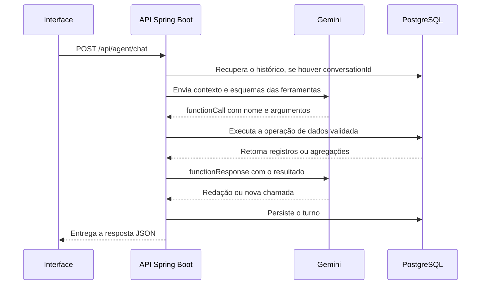

# Roteiro de apresentação — Agente de IA do DataTerra

**15 slides · cerca de 20 minutos**

## Slide 1 — O agente do DataTerra

**Na tela**

- Perguntas em linguagem natural sobre data centers no Brasil
- Respostas com dados, comparações e visualizações

**Fala** — O DataTerra reúne informações sobre instalações, operadores e sua distribuição geográfica. Criamos um agente para explorar essa base em uma conversa. Vou mostrar como uma pergunta vira uma consulta e como os dados chegam à pessoa que perguntou.

## Slide 2 — O problema que ele resolve

**Na tela**

- “Quantos data centers estão cadastrados por estado?”
- “Como São Paulo e Rio de Janeiro se comparam?”
- “Mostre o resultado em um gráfico de barras.”

**Fala** — Essas perguntas envolvem contar, agrupar, comparar e apresentar registros. A interface de chat permite encadear essas etapas em linguagem natural. A cobertura das respostas acompanha os registros da base DataTerra.

## Slide 3 — Arquitetura em três partes

**Na tela**

| Componente | Responsabilidade |
| --- | --- |
| Gemini | Interpreta a pergunta, solicita ferramentas e pode redigir a resposta |
| Java com Spring Boot | Autentica, valida e executa operações, controla a conversa e monta a resposta |
| PostgreSQL | Armazena os registros e o histórico das conversas |

**Fala** — A interface chama o backend. O Gemini sugere a operação por meio de argumentos estruturados. O código Java decide se a chamada é válida e executa a operação correspondente.



## Slide 4 — Da mensagem à resposta

**Na tela**

1. A interface envia a mensagem para `POST /api/agent/chat`.
2. O backend recupera o contexto e envia ao Gemini as ferramentas disponíveis.
3. O Gemini solicita uma operação por meio de Function Calling.
4. O backend valida a chamada, executa a operação e devolve o resultado ao modelo.
5. O backend monta e retorna a resposta HTTP.

**Fala** — Vamos acompanhar uma pergunta concreta: “Quantos data centers estão cadastrados em São Paulo?”. A pessoa escreve uma frase. Para o backend, ela vira uma chamada com duas informações: a operação é contar, e o filtro é São Paulo.

**O que mostrar no código** — Exemplo da parte relevante do retorno do Gemini:

```json
{
  "functionCall": {
    "name": "consultar_dataterra",
    "args": {
      "operacao": "CONTAR",
      "estado": "SP"
    }
  }
}
```

O `AgentService` interpreta esse objeto. O `AgentDataBaseService` valida a operação e o filtro e executa a contagem. Supondo uma base de demonstração com 42 registros em SP, o resultado volta ao Gemini em uma `functionResponse` com o total 42. O texto final descreve esse total como a quantidade cadastrada na base.

## Slide 5 — Como construímos a integração com o Gemini

**Na tela**

- `system-prompt.txt` orienta o comportamento do agente.
- `AgentToolDeclarations` define as ferramentas e os parâmetros aceitos.
- `GeminiClient` envia o contexto, recebe chamadas e devolve resultados.
- `AgentService` coordena as rodadas e monta a resposta.

**Fala** — O prompt orienta quando consultar a base ou responder a uma pergunta conceitual. Os esquemas descrevem a estrutura das chamadas. O serviço coordena esse fluxo e pode executar mais de uma operação no mesmo turno.

**Detalhe para a fala** — Na primeira rodada, o cliente usa o modo `ANY` para exigir uma chamada de ferramenta. Nas rodadas seguintes, usa `AUTO`, que permite ao Gemini propor outra chamada ou retornar texto. O backend transforma o resultado da execução em `functionResponse` e o envia como parte do histórico.

## Slide 6 — Como construímos a camada de dados

**Na tela**

- `consultar_dataterra` atende perguntas sobre os registros.
- `resposta_conceitual` atende perguntas como “O que é PUE?”.
- `AgentDataBaseService` reaproveita serviços existentes e consultas predefinidas.

**Fala** — As consultas passam pelo backend, que valida os argumentos e aciona a operação correspondente. Um ranking usa as contagens devolvidas pelo banco. Uma explicação conceitual segue um fluxo próprio, com a origem indicada na resposta.

**Detalhe para a fala** — Em um ranking por UF, o repositório agrupa os registros pela sigla normalizada, calcula `COUNT(*)` e ordena pela contagem. O limite e o deslocamento controlam a página. Quando a visualização precisa de um conjunto maior, `AgentQueryPaginationService` recupera páginas adicionais dentro dos limites do agente.

**Como o Java escolhe o caminho** — `operacao` seleciona um caso no serviço. `CONTAR` retorna um total, `ESTADOS` retorna uma agregação por UF, `LISTAR` retorna registros paginados e `NOTICIAS` busca na tabela de notícias. O serviço rejeita combinações incompatíveis, como usar `fonteId` numa contagem. Os valores aceitos viram filtros ou parâmetros vinculados às consultas existentes.

## Slide 7 — Como as notícias chegam da internet ao chat

**Na tela**

`POST /api/news/sync` → `NewsCollectorService` → RSS do Google News → tabela `noticia` → `consultar_dataterra` com `operacao=NOTICIAS`.

- A sincronização faz uma requisição HTTP ao RSS com a busca fixa `data center Brasil` e parâmetros de idioma e região para o Brasil. O Rome interpreta o XML.
- O coletor extrai título, link, veículo e data de publicação. Ele tenta resolver o link para a reportagem e usa Jsoup para obter a imagem quando disponível.
- `NewsRepository.findByUrl` procura o link do RSS. Se já existir, o coletor atualiza o registro. Se for novo, cria um registro.

**Fala** — A sincronização é uma etapa separada do chat, acionada pelo endpoint. O backend do chat pesquisa as notícias já coletadas no PostgreSQL, e a atualização desse acervo depende da última sincronização. A checagem por URL evita uma nova linha para o mesmo link em sincronizações sequenciais. Cada execução ainda pode baixar o feed, consultar a URL no banco e atualizar a notícia existente.

**Detalhe para a fala** — Para “Quais são as notícias recentes sobre energia?”, o Gemini pode solicitar `NOTICIAS` com `termo=energia`. `AgentQueryRepository.noticias` usa `JdbcTemplate` com parâmetros para procurar o termo em título, descrição e categoria. O SQL ordena por publicação decrescente e aplica `LIMIT` e `OFFSET`. A integração Gemini do chat opera com as ferramentas declaradas pelo backend e não configura busca web ao vivo. A ferramenta conceitual usa o conhecimento do modelo, e `FONTES` consulta referências documentais cadastradas.

**Exemplo para explicar os dois momentos** — Durante a sincronização, o Google News devolve um item cujo título contém “energia”. O coletor grava esse item em `noticia`, usando o link do RSS para localizar um registro existente. Mais tarde, alguém pergunta por notícias sobre energia. A palavra `energia` entra na consulta ao PostgreSQL como valor de um parâmetro. Se a notícia estiver no acervo e passar pelos filtros, ela pode aparecer na resposta com o link e o veículo. Uma notícia publicada depois da última sincronização só pode aparecer após ser incorporada à base.

**Consulta executada pelo repositório**

```sql
SELECT id, titulo, LEFT(descricao, 2000) AS descricao,
       url, fonte, categoria, data_publicacao
FROM noticia
WHERE POSITION(? IN LOWER(CONCAT(titulo, ' ', descricao, ' ', categoria))) > 0
ORDER BY data_publicacao DESC NULLS LAST, id DESC
LIMIT ? OFFSET ?
```

Os três parâmetros recebem o termo em minúsculas, o tamanho da página e o deslocamento calculado a partir da página solicitada.

## Slide 8 — Como a conversa mantém o contexto

**Na tela**

- A primeira mensagem cria um `conversationId`.
- As mensagens seguintes reenviam esse identificador.
- O histórico fica persistido no PostgreSQL e vinculado ao usuário.

**Fala** — Depois de perguntar pela distribuição por estado, a pessoa pode dizer “Mostre isso em pizza”. O identificador permite recuperar o contexto e, quando disponível para essa conversa, reutilizar o conjunto de dados anterior.

**Detalhe para a fala** — A tabela `agent_conversation` guarda o UUID, o proprietário, o histórico JSON, a versão e a data de atualização. A atualização usa controle otimista de versão. Se dois envios tentarem gravar sobre a mesma versão, o conflito retorna HTTP 409.

## Slide 9 — Como funcionam comparações e visualizações

**Na tela**

- O backend prepara conjuntos de dados a partir das consultas.
- Comparações usam as evidências disponíveis.
- `planejar_visualizacao` pode propor tipo de gráfico, campos e eixos.
- O backend valida a proposta e associa os valores consultados.

**Fala** — O Gemini pode sugerir barras para comparar estados. O Java verifica se a categoria e a métrica existem, aplica a configuração aos dados e entrega a especificação para a interface renderizar como gráfico ou tabela.

**Detalhe para a fala** — `AgentDatasetService` adapta contagens, listas e resultados paginados para conjuntos de dados com esquema e metadados. `AgentVisualizationService` verifica tipos, eixos e campos. A conversão de um gráfico para tabela pode reutilizar o mesmo `datasetId` e preservar o recorte consultado.

## Slide 10 — Rastreabilidade e recuperação de falhas

**Na tela**

- Resposta HTTP com indicação de fonte.
- Registro do SQL efetivamente executado, com exposição controlada por configuração.
- Formatação local quando há dados consultados e o Gemini falha na conclusão.

**Fala** — O backend consegue montar uma resposta a partir das evidências disponíveis se a etapa final com o Gemini falhar. Se a falha ocorrer antes de obter evidência utilizável para o fallback, a API responde com erro de indisponibilidade.

## Slide 11 — Contrato HTTP e integração com a interface

**Na tela**

Primeira chamada a `POST /api/agent/chat` em uma sessão autenticada.

```json
{
  "message": "Mostre os cinco estados com mais data centers cadastrados."
}
```

| Campo da resposta | Uso na interface |
| --- | --- |
| `response` e `fonte` | Mostrar o texto e indicar a origem da resposta |
| `conversationId` | Reenviar o identificador na próxima mensagem |
| `visualization` | Renderizar gráfico ou tabela quando houver uma especificação |
| `consulta` e `consultaOrigem` | Indicar o SQL exposto conforme a configuração e a origem da consulta |

**Fala** — A segunda chamada envia `message` e o `conversationId` recebido na primeira. `chartData` é um alias de `visualization` no contrato. A interface deve renderizar apenas um dos campos para evitar duplicar a visualização.

## Slide 12 — Quando o agente evita repetir SQL

**Na tela**

| Cenário | Decisão do backend |
| --- | --- |
| O Gemini repete `consultar_dataterra` com os mesmos argumentos dentro de uma requisição | `AgentService` reutiliza o resultado no `HashMap` local, cuja chave é uma cópia do mapa de argumentos efetivos. Uma chamada diferente pode executar SQL próprio. |
| A pessoa pede outro formato para o mesmo resultado | O backend recupera o `datasetId` da conversa do usuário e reconstrói a visualização com o conjunto anterior. Se o histórico guardou apenas os metadados e marcou `_requiresRefresh`, o fluxo de conversão reconhecido pode buscar os dados novamente com os filtros salvos. |
| A pessoa compara contagens de dois estados | `AgentComparisonService` procura a contagem mais recente de cada UF nas evidências disponíveis. Só aceita uma operação `CONTAR` cujo único filtro seja o estado. Consulta a UF que faltar ou consulta as duas quando recebe `atualizar=true`. |

**Fala** — Dentro de um turno, se a ferramenta solicitar duas vezes `CONTAR` para `SP` com o mesmo mapa de argumentos, a segunda chamada usa o mesmo resultado, inclusive a evidência SQL da primeira execução. O mapa é descartado ao fim da requisição. Em outro turno, repetir a mesma pergunta como uma nova busca pode executar o SQL outra vez. As reutilizações entre turnos dependem das evidências persistidas na conversa autenticada e dos critérios de cada operação.

**Detalhe para a fala** — Se São Paulo já foi contado e falta o Rio de Janeiro, a comparação consulta somente o Rio e calcula a diferença em Java. Com a exposição de SQL habilitada, `consultaOrigem` permite distinguir SQL `atual`, do `historico` ou de origem `mista`. Uma conversão que reaproveita dados ainda pode ler ou gravar o histórico no PostgreSQL. A execução evitada é a consulta que recuperaria novamente os dados do gráfico.

**Exemplo para apresentar, com números fictícios**

1. **“Quantos em SP?”** O cache começa vazio. O Java executa `CONTAR/SP`, recebe 42 e guarda o resultado sob os argumentos efetivos. Se o Gemini pedir a mesma ferramenta com os mesmos argumentos em outra rodada dessa requisição, recebe os 42 do cache.
2. **“Compare com o RJ.”** É outra requisição e o cache local começa vazio. A ferramenta de comparação encontra a contagem de SP entre as evidências da conversa. Se faltar RJ, executa `CONTAR/RJ`. Supondo que o banco devolva 18, o Java calcula a diferença de 24. O resultado combina um valor histórico com um valor atual.
3. **“Atualize os dois números.”** Se o Gemini acionar a comparação com `atualizar=true`, o serviço consulta SP e RJ. Uma nova pergunta de contagem isolada também pode executar SQL novamente.

**O que determina um acerto de cache** — A igualdade é entre mapas de argumentos, não entre frases. Mudar `pagina`, `limite` ou qualquer outro argumento efetivo muda a chave. Uma chamada aceita que omite um parâmetro e outra que envia explicitamente o valor padrão também podem gerar chaves distintas. O reaproveitamento por `datasetId` tem outra finalidade: preservar os mesmos valores e filtros ao mudar só o formato de exibição.

## Slide 13 — Como validamos a implementação

**Na tela**

- Testes unitários para orquestração, formatação e regras de visualização.
- Testes de integração para consultas, memória e isolamento entre usuários.
- Cenários de conversão de gráficos e de falha do Gemini.

**Fala** — Os testes de integração locais usam H2 em modo PostgreSQL e simulam a comunicação com o Gemini. Assim é possível exercitar de forma reproduzível o caminho entre a chamada de ferramenta, a consulta e a resposta do backend.

**Detalhe para a fala** — `AgentConversationIntegrationTests` exercita a continuidade da conversa. `AgentVisualizationIntegrationTests` cobre conversões de visualizações e reutilização de dados. `AgentRawSqlIntegrationTests` verifica a captura do SQL em cenários de resposta normal e de falha do Gemini.

## Slide 14 — Demonstração em três mensagens

**Na tela**

1. “Mostre os cinco estados com mais data centers cadastrados.”
2. “Apresente esse resultado em um gráfico de barras.”
3. “Agora mostre os mesmos dados em uma tabela.”

**Fala e ação** — Envie as três mensagens na mesma conversa. Na primeira resposta, aponte o recorte consultado. Ao alternar entre gráfico e tabela, compare o `datasetId`, os estados e as contagens. Se a exposição de SQL estiver habilitada no ambiente, mostre como `consultaOrigem` identifica o reaproveitamento quando o conjunto anterior está disponível.

## Slide 15 — Encerramento

**Na tela**

- Gemini interpreta a pergunta e solicita uma operação.
- Spring Boot valida a operação e consulta os dados.
- As notícias chegam por sincronização RSS e ficam disponíveis para busca no banco.
- O backend reaproveita resultados no turno e evidências compatíveis da conversa.

**Fala** — O agente transforma perguntas do dia a dia em operações sobre a base DataTerra. A mesma conversa permite consultar um recorte, comparar resultados e mudar a forma de exibição.

---

## Material de apoio para o apresentador

- [Arquitetura, ferramentas e contrato HTTP](AGENT.md)
- [Memória, comparações e exemplos de conversa](AGENT-CONVERSAS.md)
- [Datasets e contrato de visualização](VISUALIZACOES.md)
- [Coletor do RSS](src/main/java/data_centers/brasil/service/NewsCollectorService.java)
- [Cache por requisição e reutilização de datasets](src/main/java/data_centers/brasil/agent/service/AgentService.java)
- [Reutilização de contagens](src/main/java/data_centers/brasil/agent/service/AgentComparisonService.java)
